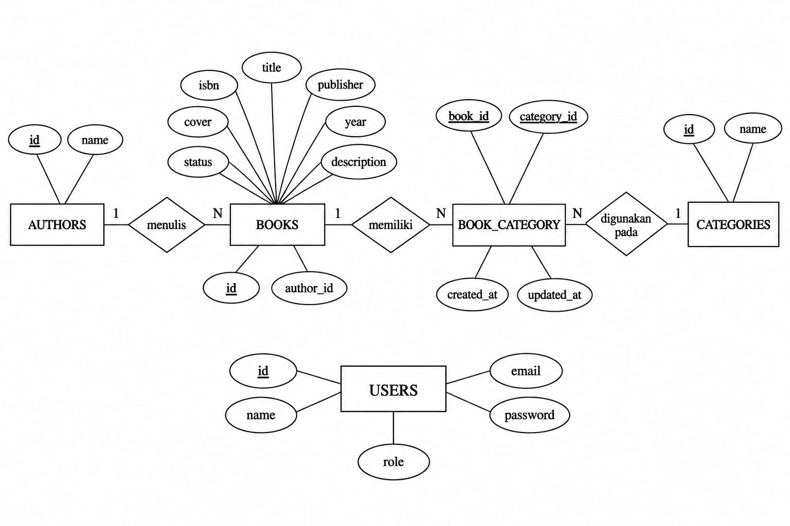

# LAPORAN TUGAS 3
## Praktikum Laravel dan Filament 3.3

**Nama:** Rizka Ainun Nazori  
**NPM:** 4524210092  

---

## 1. Arsitektur Sistem

### 1.1 Deskripsi Sistem

Sistem yang dibuat merupakan aplikasi manajemen perpustakaan berbasis web menggunakan Laravel dan Filament. Aplikasi ini digunakan untuk mengelola data buku, penulis, kategori buku, serta status buku.

Fitur yang terdapat pada sistem antara lain:
- Mengelola data buku.
- Mengelola data penulis.
- Mengelompokkan buku berdasarkan kategori.
- Mengatur hak akses pengguna berdasarkan role.
- Menampilkan statistik data buku pada dashboard.

### 1.2 Entity Relationship Diagram (ERD)

ERD berikut menggambarkan hubungan antar tabel pada sistem perpustakaan.

### 1.3 Relasi Antar Tabel

- **Authors dan Books:** Satu penulis dapat memiliki banyak buku, sedangkan satu buku memiliki satu penulis. Relasi ini menggunakan `author_id` pada tabel `books`.
- **Books dan Categories:** Satu buku dapat memiliki beberapa kategori dan satu kategori dapat digunakan oleh beberapa buku. Relasi ini menggunakan tabel pivot `book_category`.
- **Users:** Tabel users menyimpan data pengguna dan role untuk mengatur hak akses ke dalam sistem.

### 1.4 Alur Request dan Response

1. Pengguna membuka aplikasi melalui browser.
2. Request dikirim ke Laravel melalui route.
3. Laravel memproses request melalui controller atau komponen Filament.
4. Sistem berinteraksi dengan model untuk mengambil atau mengubah data pada database.
5. Data dikirim kembali dan ditampilkan pada halaman aplikasi.

Laravel menggunakan pola MVC (Model, View, Controller). Model mengelola data, View menampilkan antarmuka, dan Controller menangani alur request. Pada Filament, halaman dan resource menyediakan antarmuka pengelolaan data secara lebih praktis.

---

## 2. Perbandingan Filament dan CRUD Manual

### 2.1 Perbandingan

| Aspek | Filament | CRUD Manual |
|---|---|---|
| Pembuatan halaman | Menggunakan Resource dan komponen yang tersedia | Membuat route, controller, dan view sendiri |
| Form input | Menggunakan komponen form Filament | Membuat form HTML sendiri |
| Tabel data | Menggunakan Table Filament | Membuat tabel dan fitur pengelolaan sendiri |
| Validasi | Dapat diatur melalui komponen form | Mengatur validasi melalui controller |
| Waktu pengerjaan | Lebih cepat | Membutuhkan waktu lebih lama |
| Fleksibilitas | Mengikuti struktur dan komponen Filament | Lebih bebas menyesuaikan tampilan dan alur |

### 2.2 Kelebihan dan Kekurangan

**Kelebihan Filament:**
- Mempercepat pembuatan halaman admin.
- Menyediakan komponen form dan tabel.
- Memiliki fitur pencarian, filter, dan aksi data.
- Tampilan admin lebih konsisten.

**Kekurangan Filament:**
- Perlu mempelajari struktur dan cara kerja Filament.
- Tampilan dan alur tertentu mengikuti komponen yang tersedia.
- Kustomisasi yang sangat spesifik dapat membutuhkan pemahaman lebih lanjut.

**Kelebihan CRUD Manual:**
- Tampilan dan alur dapat dibuat sesuai kebutuhan.
- Memberikan pemahaman lebih mendalam tentang Laravel.
- Tidak bergantung pada struktur komponen admin tertentu.

**Kekurangan CRUD Manual:**
- Membutuhkan lebih banyak kode.
- Fitur seperti pencarian, filter, dan pagination harus dibuat atau diatur sendiri.
- Waktu pengerjaan lebih lama.

### 2.3 Kapan Menggunakan Filament atau CRUD Manual?

Filament cocok digunakan untuk aplikasi yang membutuhkan panel admin dengan fitur pengelolaan data secara cepat, seperti sistem perpustakaan, inventaris, dan dashboard administrasi.

CRUD manual lebih cocok digunakan ketika aplikasi membutuhkan tampilan khusus, alur yang kompleks, atau ketika tujuan pembelajaran adalah memahami proses CRUD Laravel secara langsung.

---

## 3. Refleksi

### 3.1 Hal yang Dipelajari

Melalui praktikum ini, saya mempelajari cara membangun aplikasi manajemen data menggunakan Laravel dan Filament. Saya juga memahami penggunaan relasi antar tabel, pengelolaan data melalui Resource, pengaturan hak akses pengguna, serta pembuatan statistik pada dashboard.

### 3.2 Kesulitan dan Solusi

Kesulitan yang dihadapi adalah memahami hubungan antar tabel dan menyesuaikan fitur Filament dengan kebutuhan aplikasi. Selain itu, proses konfigurasi dan perbaikan error membutuhkan ketelitian.

Solusinya adalah mempelajari kembali struktur Laravel dan Filament, memeriksa kode yang digunakan, serta melakukan pengujian secara bertahap setelah menambahkan fitur.

### 3.3 Pengembangan Selanjutnya

Aplikasi dapat dikembangkan dengan menambahkan fitur peminjaman dan pengembalian buku, pencatatan transaksi, pencarian yang lebih lengkap, serta laporan data perpustakaan.

---

## 4. Kesimpulan

Laravel dan Filament membantu proses pengembangan aplikasi manajemen perpustakaan menjadi lebih praktis. Filament menyediakan komponen untuk pengelolaan data sehingga proses pembuatan panel admin dapat dilakukan lebih cepat. Melalui praktikum ini, saya memahami penerapan relasi database, CRUD, hak akses pengguna, dan dashboard dalam aplikasi berbasis web.
